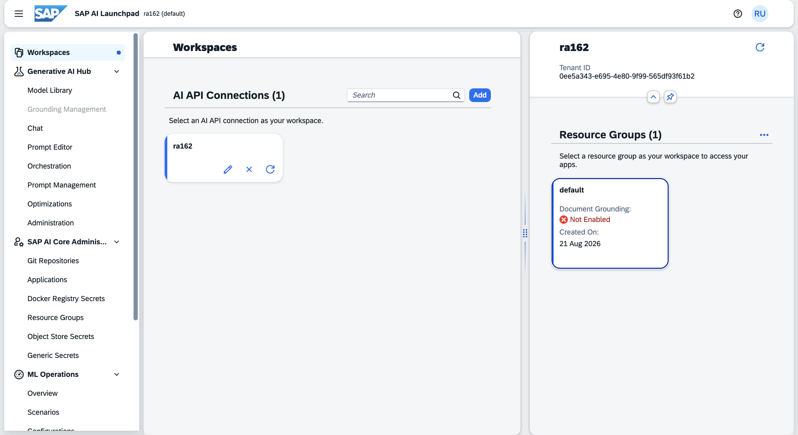
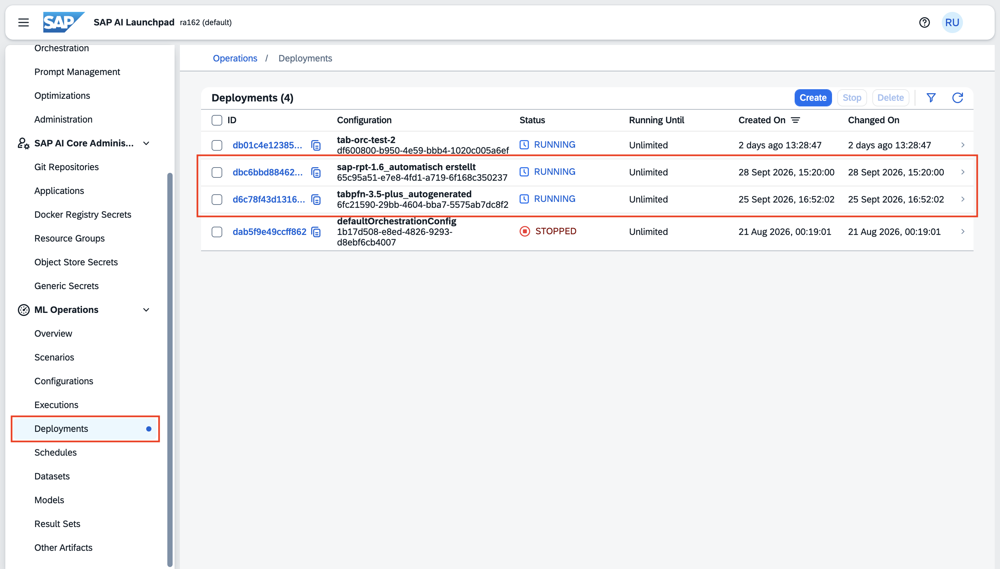
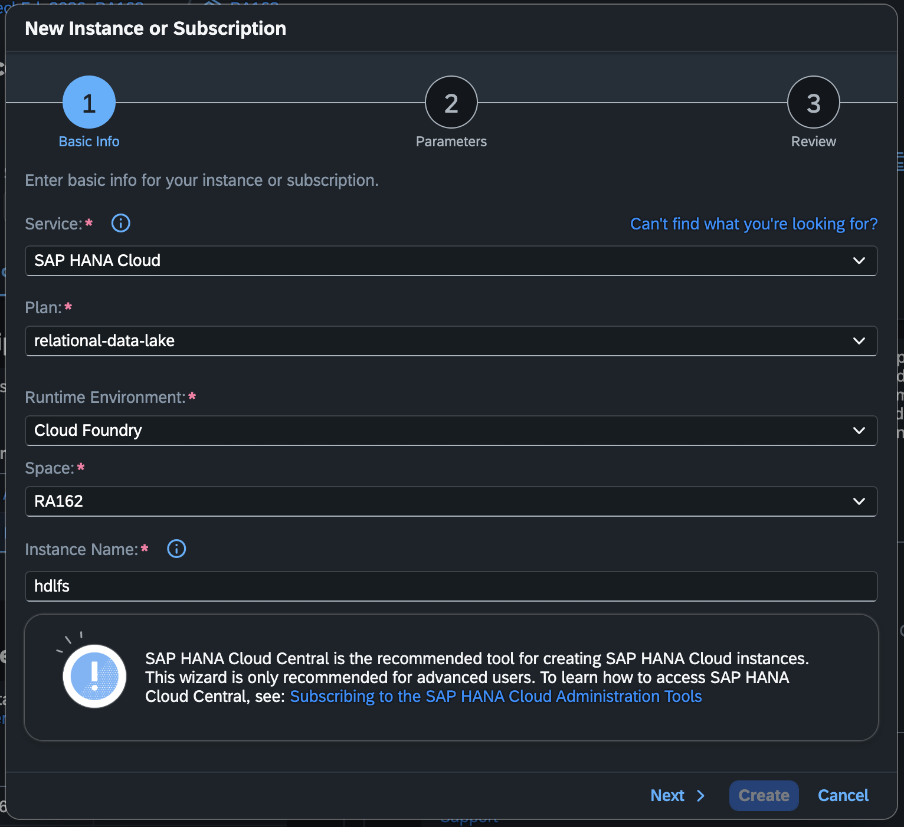
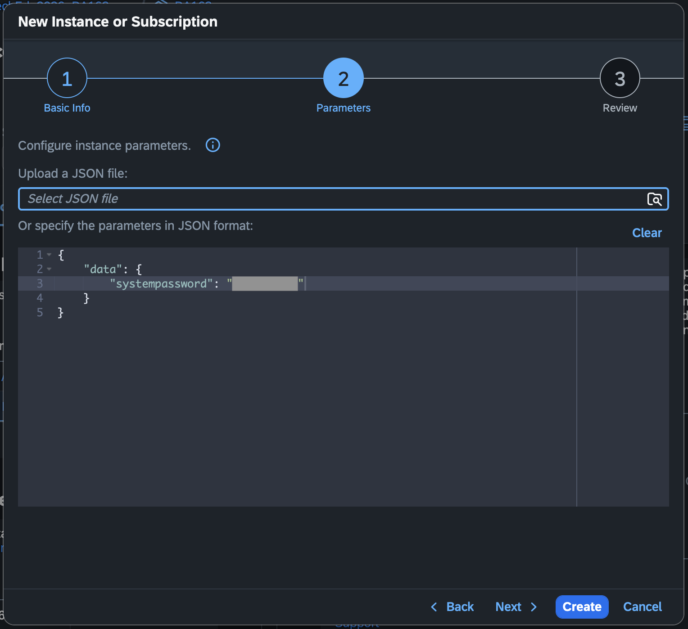
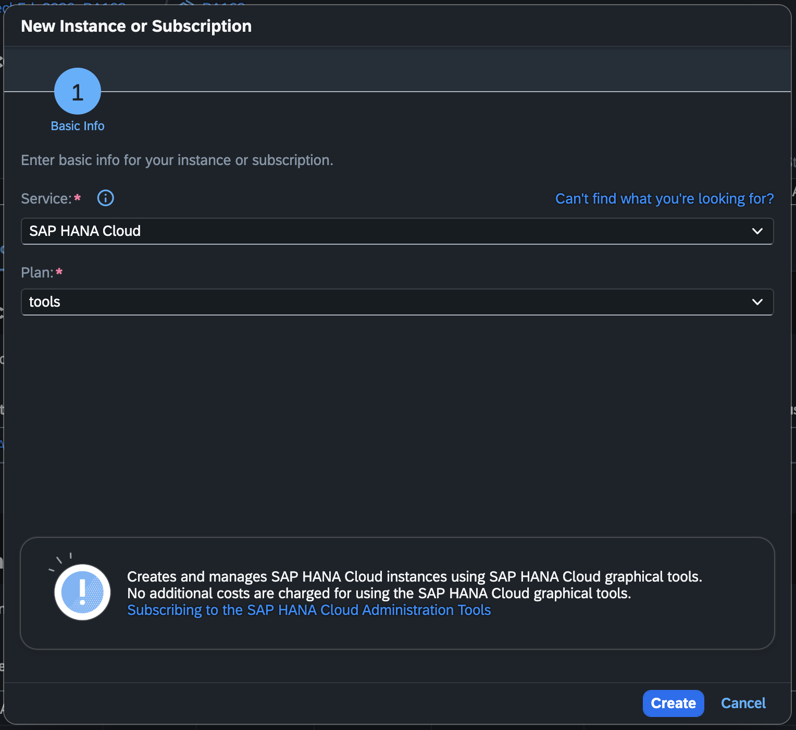
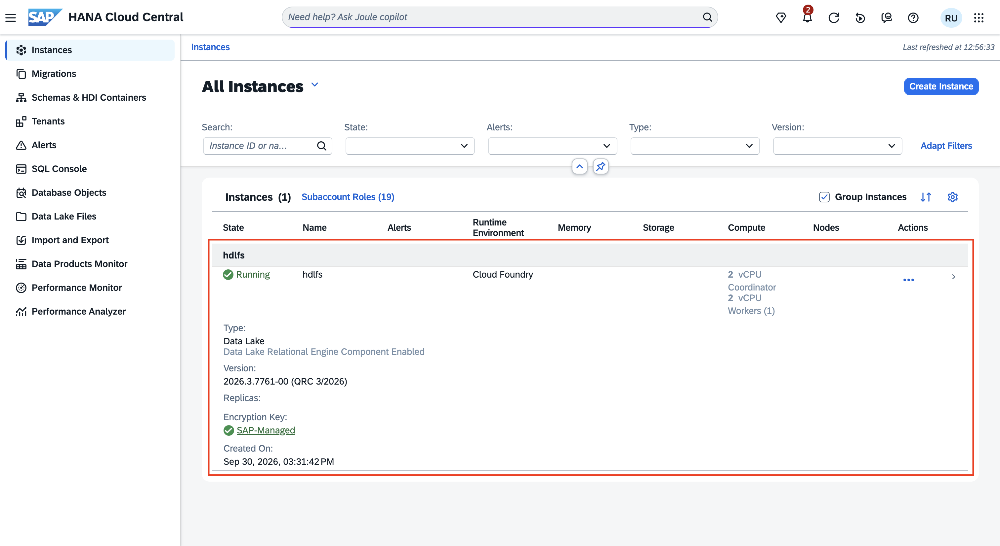
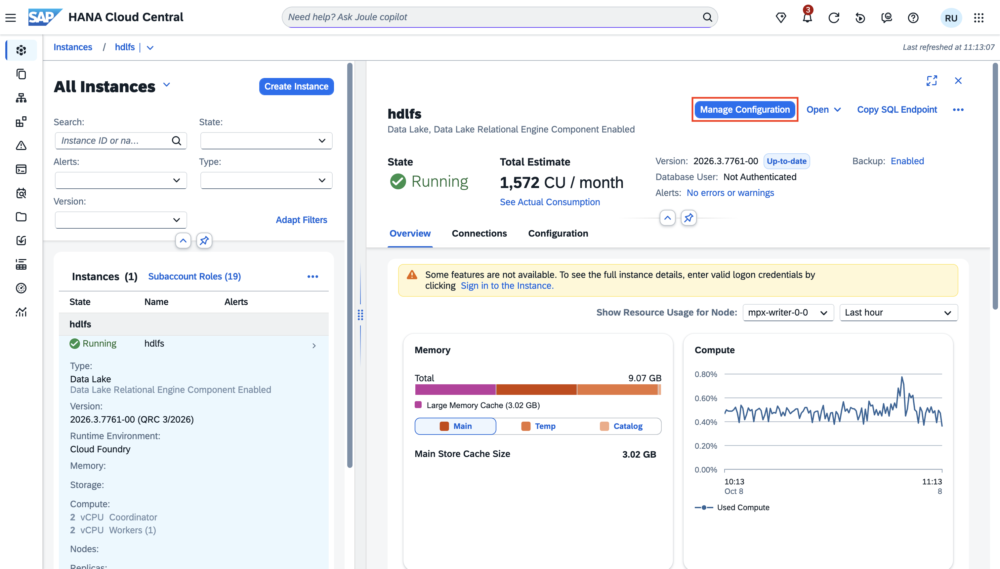
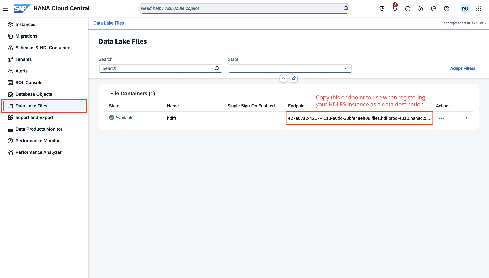

# Getting Started on Tabular AI

To access our tabular foundation models (SAP-RPT models, TabPFN models), there are 2 possible modes of consumption:
1. Via direct API call to each model (Exercises 1 and 2)
2. Via API call to the Tabular AI orchestration workflow (Exercise 3)

You can head directly to [Exercise 1 - SAP-RPT-1.6](../ex1/README.md) to get started with our exercises. Make sure to setup a virtual environment before proceed with the exercises. See section below.

If you would like to replicate the exercises on your own setup, do note that there are additional steps to set up AI Core, AI Launchpad and HANA Cloud. You can see the instructions below. Do note that you do not need to go through the following steps during the on-site session.

## Setting up a Virtual Environment for the exercises

Open the terminal in Visual Studio Code. 

Run the following command to create the local environment.
```
Windows: py -m venv venv
Mac: python3 -m venv venv
```

You should see that a `venv` folder is created in the root directory. 

Run the following command to activate the virtual environment.
```
Windows: venv\Scripts\activate
Mac: source venv/bin/activate
```

Once the virtual environment is up, install the required libraries using the provided `requirements.txt` file.
```
cd exercises
pip install -r requirements.txt
```

## Preparing the .env file

You should see a `.env.example` file. Rename the file to `.env` and open this file. You would see that we have already prepared some environment variables in the file:
```
AICORE_AUTH_URL=<url in RA162-SK.json file>/oauth/token
AICORE_CLIENT_ID=<clientid in RA162-SK.json file>
AICORE_CLIENT_SECRET=<clientsecret in RA162-SK.json file>
AICORE_RESOURCE_GROUP=default
AICORE_BASE_URL=<AI_API_URL in RA162-SK.json file>
RPT_DEPLOYMENT_ID=YOUR_SAP_RPT_1.6_DEPLOYMENT_ID
TABPFN_DEPLOYMENT_ID=YOUR_TABPFN_3_5_PLUS_DEPLOYMENT_ID
TABORC_DEPLOYMENT_ID=YOUR_TAB_ORCHESTRATION_DEPLOYMENT_ID
TABORC_HDLFS_HOST=<hdlfs-host in RA162-SK.json file>
TABORC_HDLFS_URL=<hdlfs-url in RA162-SK.json file>
```

Unzip `credentials.zip` file and open the `RA162-SK.json` file. Copy the required values from this JSON file into your `.env` file.

# Familiarise yourself with SAP generative AI hub

Follow the steps in the [Initial Setup](https://help.sap.com/docs/sap-ai-core/sap-ai-core-service-guide/initial-setup?locale=en-US&ai=true) guide to provision an AI Core instance.

For easier access of AI Core features, we would recommend that you provision AI Launchpad as well. 

### Accessing AI Launchpad
If this is your first time setting up AI Launchpad, you will need to go through the following steps:
1. Click **Add** to create a new AI API connection. 


2. Provide a name for the AI API connection.
3. Upload the service key JSON file and the rest of the fields should be auto-populated. You can follow the steps [here](https://help.sap.com/docs/sap-ai-core/sap-ai-core-service-guide/create-service-key?locale=en-US&ai=true) to create the service key from your provisioned AI Core instance.


4. Click **Create** to create the AI API connection.
5. Once created, the connection should come with the **default** resource group, which should also be auto-selected. You can go ahead to create new resource group if you require additional partitions.



### Deploying the models
> Note: For the on-site session, we have already deployed the models on your behalf. You can follow the steps in Exercises 1 and 2. 

If you would like to repeat this tutorial on your own, you will need to deploy the models on your own AI Core instance. Here are the steps to do so.
1. Head to **Model Library** under **Generative AI Hub** via the left navigation bar.


2. Within the **Model Library**, search for SAP RPT 1.6.


3. Click on the SAP RPT 1.6 model. 
4. Click Deploy.


5. Repeat steps 2 to 4 to deploy the TabPFN-3.5 Plus model.


6. Head to **Deployments** under **ML Operations** via the left navigation bar.



7. You should see the 2 new model deployments that you have created.
8. Once deployment is completed, you should see that the status indicates **RUNNING**.

### Getting the deployment URL for the models
1. Click into each deployment and you should see a deployment URL.
2. Copy this deployment URL.


3. Add `/predict` to the end of the URL when making direct API inference requests to the model.

For API specifications of SAP-RPT-1.6, you can read more on [Help Portal](https://help.sap.com/docs/sap-ai-core/generative-ai/sap-rpt-1-6?locale=en-US&ai=true).
For API specifications of TabPFN-3.5 Plus, you can read more on [Help Portal](https://help.sap.com/docs/sap-ai-core/generative-ai/tabpfn-3-5-plus?locale=en-US&ai=true).

## Preparing HANA Data Lake File System (HDLFS)

### Provisioning SAP HANA Cloud
In your BTP subaccount, you should provision the **relational-data-lake** plan for SAP HANA Cloud.




We would also recommend that you provision the **tools** plan for SAP HANA Cloud to better navigate its features. 



### Accessing the SAP HANA Cloud UI
You should be able to see 1 instance in the SAP HANA Cloud dashboard once everything has been properly setup.




Select the instance and click **Manage Configuration**.



Make sure to select "Allow all IP addresses" under the **Connections** section.


You can refer to Steps 3 and 4 on how to generate the certificate and update the trust configuration in this [developer tutorial](https://developers.sap.com/tutorials/data-lake-file-containers-hdlfscli/) for HANA Data Lake File System. After following with these steps, you should have added the generated certificate under the **Trusts** section as well as a new authoriation with a binding to the certificate under the **Authorizations** section.


Make sure to save the new settings.

### Getting the HDLFS endpoint for registering it as a Data Destination
You will require the HDLFS endpoint when registering your HDLFS instance as the data destination to run the Tabular AI orchestration workflow. Head to **Data Lake Files** and you should see a line item under **File Containers**. Use this endpoint for registrating the data destination.



### Adding subject patterns to your HDLFS instance after registering it as a Data Destination

When you have created a new data destination, you should receive 2 patterns in the response payload. Add these 2 patterns to the settings in your HDLFS instance. All in all, you should have 3 items under **Authorizations**.


Make sure to save the new settings. 

## API Collection
We have additionally provided a set of API calls, available as a Bruno collection or Postman collection. You can find these files in the **api** folder. You can download your preferred file and get started with using SAP-RPT-1.6, TabPFN-3.5 Plus and Tabular AI orchestration workflow via APIs.

We have created environment variables. You can fill it in with the values from your own setup before running the APIs.